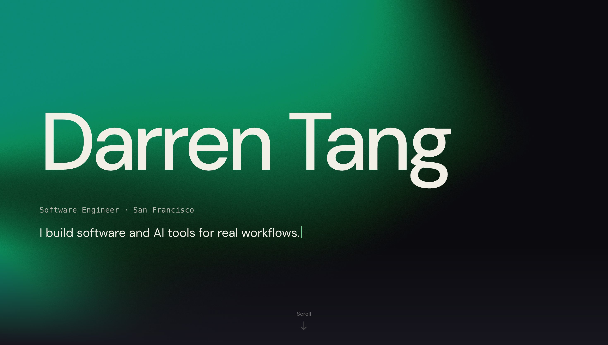
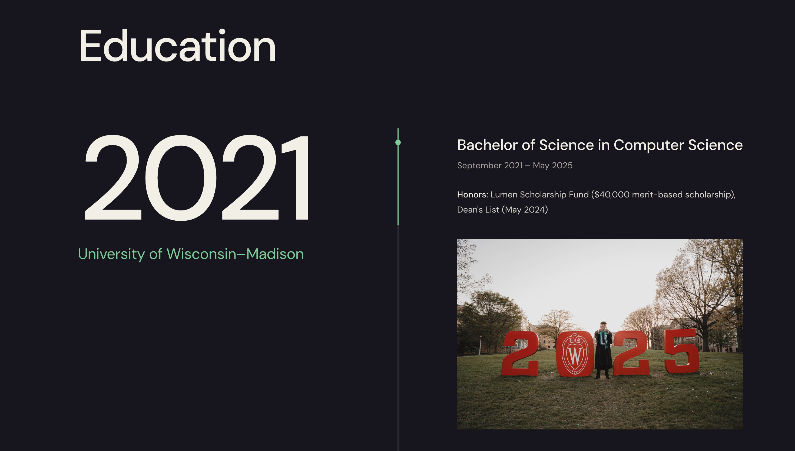
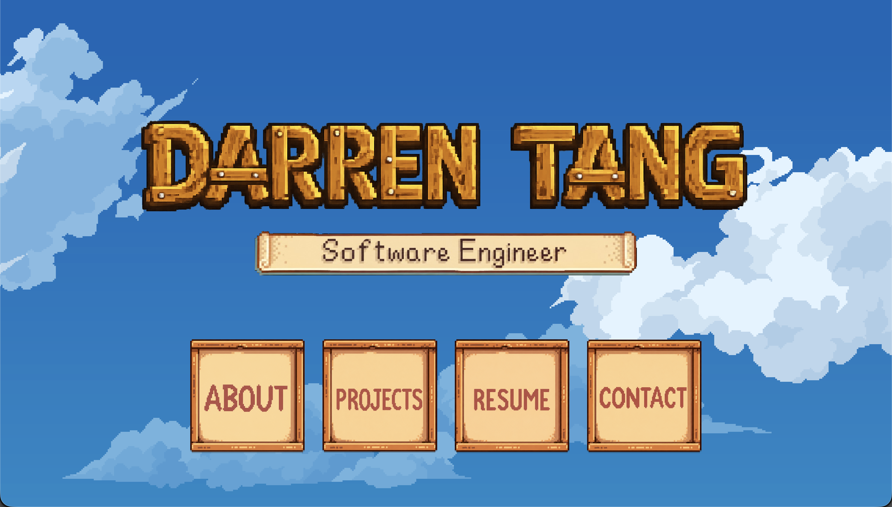
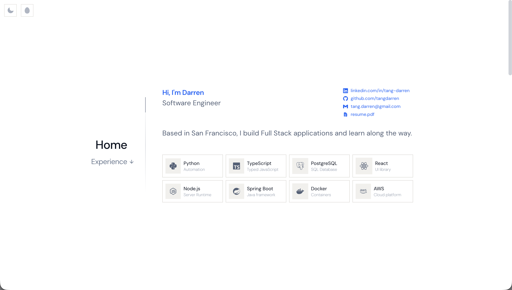
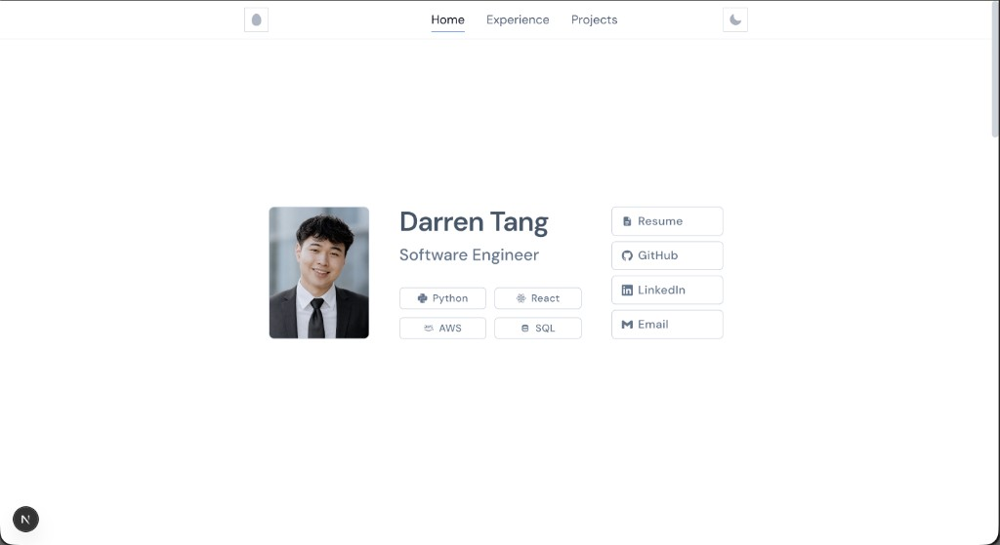
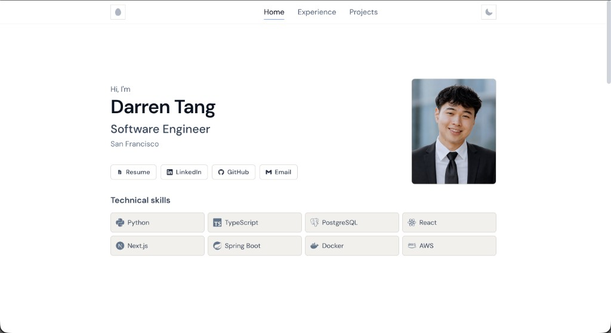
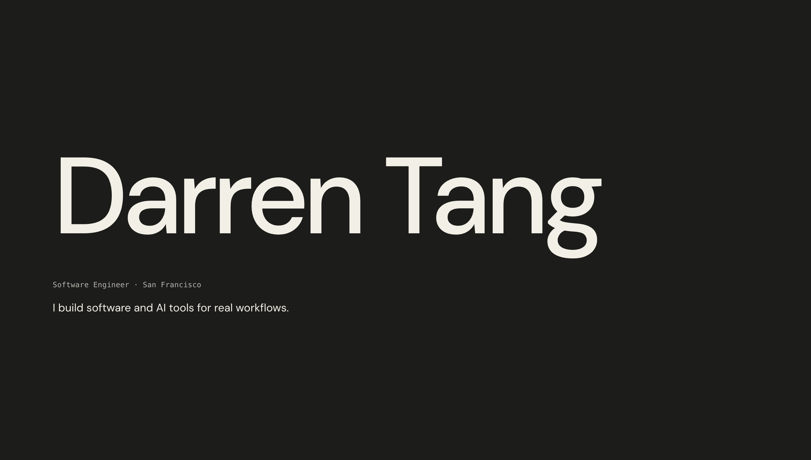

# tangdarren.com

My personal website. It's one long page: my name, where I've studied and worked, the things I've built, and how to reach me. Built with Next.js, React, and TypeScript.

**[Visit the site](https://tangdarren.com/)**



## What's on it

- **The intro.** My name types itself out, slides into place, and a green cursor finishes the sentence underneath. The background is an animated grainy gradient I first made for my [stock market dashboard](https://github.com/tangdarren/stock-market-dashboard).
- **Education and Experience.** A timeline that runs oldest to newest. The year stays pinned on the left while a green line draws down the page as you scroll, then turns into a horizontal line between Education and Experience. Each school and job has a photo.
- **More photos.** A small gallery of things outside the timeline: visiting Meta and the Tesla factory, hiking, high school debate, and some early projects.
- **Projects.** Everything I've built, each linking to its code. A few have longer case studies at `/projects/<name>`.
- **Contact.** Email, GitHub, LinkedIn, and my résumé.



## Run it locally

Use Node.js 24 (the same version CI uses).

```sh
npm ci
npm run dev
```

Then open [localhost:3000](http://localhost:3000). No credentials needed. The only optional setting is `SITE_URL` in `.env` (copy `.env.example`); leave it blank and it uses tangdarren.com.

## Changing things

Almost everything you'd want to edit is data, not code:

- `src/data/experience.ts`: schools and jobs, their dates, bullets, and photos. This should match my résumé.
- `src/data/homepage.ts`: the project list, in the order it appears.
- `src/data/gallery.ts`: the "More photos" gallery.
- `src/data/projects.ts`: the longer case studies.
- `public/`: photos, the gallery, and the résumé PDF. Everything in here is public.

To add a timeline photo, drop a 3:2 landscape image (1400px wide is plenty) in `public/timeline/` and add a `photo` with a short description to that entry. Phone photos should be resized and have their location data stripped first.

The main pieces of code are `src/views/HomePage.tsx` (the intro), `src/components/home/Chronicle.tsx` (timeline, projects, contact), `src/components/home/PhotoGallery.tsx`, and `src/components/home/Grainient.tsx` (the background).

Before pushing, run `npm run lint`, `npm run typecheck`, `npm test`, and `npm run build`.

## How it got here

This site has been through a lot of versions. Here they are, oldest first.

**v1: The pixel-art game menu.** My first version looked like the title screen of a farming game: wooden letters, clouds, and four big signboard buttons for About, Projects, Résumé, and Contact. It was fun, but it was a menu, not a page.



**v2: Clean and minimal.** I went the other way: plain white, a short intro, my links, and a grid of the tools I use. Easier to read, but a bit empty.



**v3: The business card.** A headshot, my name and title, a few skills, and buttons for my résumé and socials, all in one compact row under a simple top bar.



**v4: The profile page.** Same idea with more room: a bigger name, the headshot on the right, and a full row of technical skills. Around this time I also added a retro computer that assembled itself as an intro, a light and dark mode, and a little Golden Gate Bridge easter egg.



**v5: Name first.** I dropped almost everything and let my name fill the screen on a dark background, with one line about what I do. This is where the typing intro started.



**v6: Today.** The green gradient, the cursor that carries on into the timeline, and everything (education, experience, projects, contact) back on a single page. The old separate About, Contact, and Résumé pages, the easter egg, and the retro intro are gone. Old links still work: they redirect to the matching section.


